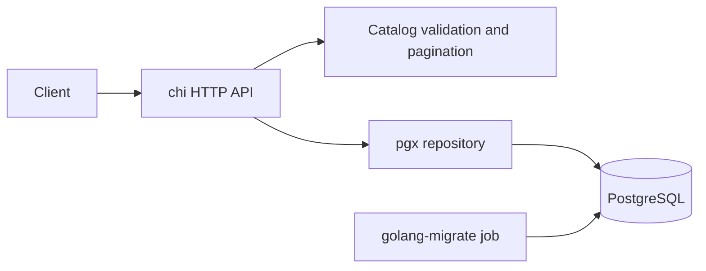

# Catalog design

## Decisions and scope

This design implements [requirements](requirements.md) and [use cases](use-cases.md). The initial deployment is one stateless Go API and one PostgreSQL primary. Approximately 300,000 rows and a high read/write ratio do not, by themselves, justify sharding or another data system. Measure workload, row sizes, concurrency, and query plans before adding infrastructure.

## Why PostgreSQL

The product model is structured; CRUD requires immediate visibility and unique SKUs; browsing combines optional equality and range predicates. PostgreSQL supplies transactions, unique/check constraints, parameterized SQL, and B-tree indexes in one operational system. A primary avoids replication lag in the stated read-after-write contract. This is an architectural judgment for this workload, not a claim that other databases cannot implement a catalog.

| Candidate | Fit and reason for this decision |
| --- | --- |
| PostgreSQL — selected | Straightforward authoritative CRUD, constraints, and flexible indexed filters. The proposed `(category, price_cents, id)` index places equality before the range/order keys, following PostgreSQL's [multicolumn B-tree behavior](https://www.postgresql.org/docs/current/indexes-multicolumn.html). |
| MongoDB | A viable alternative with compound indexes, single-document atomicity, and [multi-document transactions](https://www.mongodb.com/docs/manual/core/transactions/). Flexible nested documents would help a heterogeneous attributes model, but that is not required here. PostgreSQL makes this version's rigid invariants and potential relational extensions direct; MongoDB would not remove a demonstrated bottleneck. |
| Elasticsearch | Valuable for relevance-ranked search, typo tolerance, and complex search aggregations. None is required. Search visibility depends on [refresh behavior](https://www.elastic.co/docs/manage-data/data-store/near-real-time-search); synchronizing an additional search index would add failure modes. If introduced later, PostgreSQL remains authoritative and an outbox/CDC pipeline maintains the index. |
| DynamoDB | Strong for predictable key access and managed scaling. Category plus price can be modeled using partition/sort keys, but global price browsing and future filter combinations require additional access patterns/indexes. [Query requires a partition-key value and applies non-key filters after reading; GSIs offer eventual consistency](https://docs.aws.amazon.com/amazondynamodb/latest/APIReference/API_Query.html). This is unnecessary modeling/consistency complexity at this scale. |
| ClickHouse | Excellent for large analytical scans and aggregations. It supports updates/deletes, including [lightweight updates](https://github.com/ClickHouse/clickhouse-docs/blob/main/docs/managing-data/updating-data/overview.mdx); older blanket claims that it cannot update rows are inaccurate. Its columnar analytical design and mutation tradeoffs do not match a small transactional source of truth with unique SKUs. Consider it downstream for sales/catalog analytics. |

## Components and libraries



Go 1.26 or newer; builds use Go 1.26.10. PostgreSQL 17 is the supported database version. Docker Compose v2 runs local and acceptance environments.

* `github.com/go-chi/chi/v5`: routing, request IDs, recovery middleware, HTTP compatibility. See [chi](https://github.com/go-chi/chi).
* `github.com/go-playground/validator/v10`: declarative field validation; small explicit checks cover domain patterns and price presence. See [validator](https://github.com/go-playground/validator).
* `github.com/jackc/pgx/v5`: typed PostgreSQL access and bounded connection pool. See [pgx](https://github.com/jackc/pgx).
* `github.com/google/uuid`: UUID parsing/generation.
* `github.com/stretchr/testify`: test assertions; `github.com/pashagolub/pgxmock/v4`: repository failure-path unit tests.
* `golang-migrate/migrate` container: versioned up/down SQL migrations, locking, and dirty-version tracking. Migrations run as a deployment step before the API, not in each replica.

Packages: `internal/catalog` owns product contracts, validation, query parsing and cursor encoding; `internal/postgres` owns SQL; `internal/httpapi` owns HTTP behavior; `internal/app` owns configuration/lifecycle; `cmd/catalog` is a minimal entry point. Interfaces sit at consumer boundaries. A pass-through service layer or ORM would add little to this CRUD domain. SQL stays explicit so indexes and queries can be reviewed together.

## Schema and queries

`products`: UUID primary key; SKU unique; name/description/category text; price_cents BIGINT; created_at/updated_at TIMESTAMPTZ. CHECK constraints enforce lengths, patterns, nonblank names, and price bounds. `created_at`/`updated_at` default to database clock time; updates set updated_at to at least one microsecond after its previous value. API timestamps serialize in UTC. Delete physically removes the row.

Indexes:

1. Primary key `(id)` for point reads/writes.
2. Unique `(sku)` for concurrent uniqueness.
3. `(price_cents, id)` for global lists and price filters.
4. `(category, price_cents, id)` for category lists with optional price ranges.

Build parameterized SQL only for supplied predicates, avoiding catch-all `OR $param IS NULL` conditions. Field names and sort direction are fixed by application code. A typical continuation query is:

```sql
SELECT id, sku, name, description, category, price_cents, created_at, updated_at
FROM products
WHERE category = $1 AND price_cents >= $2 AND price_cents <= $3
  AND (price_cents, id) > ($4, $5)
ORDER BY price_cents, id
LIMIT $6; -- requested limit + 1
```

Fetching one extra row detects continuation without COUNT(*). A cursor is bounded base64url JSON containing a format version, last price/UUID, and a SHA-256 fingerprint of the filters. It binds category and bounds, but allows changing limit. Cursors are opaque client contracts, not credentials: they are intentionally unsigned, and changing one can only move a public listing position. Decode validates structure, version, UUID, price and filter fingerprint. No secret or authorization claim is encoded.

Keyset pagination avoids work proportional to the page offset. Ordering includes UUID to break equal-price ties. Across separate requests, PostgreSQL READ COMMITTED yields live pages, not a fixed snapshot; mutable sort keys may move products past/before the cursor. No snapshot guarantee is advertised.

Writes are single atomic SQL statements with RETURNING. No-row results map to not found. Unique-violation code 23505 on `products_sku_key` maps to conflict; other unique violations remain internal failures. Violations of the five known product field CHECK constraints map to invalid input; unexpected constraints, NOT NULL violations, SQL syntax/schema errors, authentication/configuration errors reported by PostgreSQL, protocol errors and scan/driver bugs remain internal failures. The repository classifies every result path, including DELETE, initial list queries, row scans and terminal iteration errors, and wraps domain sentinels while retaining the underlying cause. PUT uses last committed write wins, explicitly accepting lost updates; version/If-Match checks are a future requirement if concurrent editing needs protection. The SQL row lock serializes replacements; timestamps advance by at least one microsecond relative to the preceding row version, even when the wall clock has not advanced. POST is not an idempotent operation; callers can resolve uncertain outcomes via SKU conflict/listing.

Persistence failures use these HTTP mappings:

| Condition | Status / code |
| --- | --- |
| Product not found | 404 / `not_found` |
| Duplicate SKU | 409 / `conflict` |
| Invalid client input, including known field CHECK violations | 400 / `validation_error` |
| Connection failures, network errors/EOF, database-operation deadlines/cancellation | 503 / `unavailable` |
| PostgreSQL connection exceptions (08000/08001/08003/08004/08006/08007), too many connections (53300), shutdown/recovery (57P01/57P02/57P03), query cancellation (57014), lock timeout/unavailability (55P03) | 503 / `unavailable` |
| Unexpected SQL, constraints, protocol (08P01), or internal persistence failures | 500 / `internal_error` |

Classification uses typed errors/SQLSTATEs, never error-message matching. Column scan/conversion errors remain internal even if their codec cause is EOF or a timeout. Otherwise a SQLSTATE takes precedence over a connection wrapper so server-reported SQL/authentication bugs do not become transient failures. No retries are introduced: a connection loss during a write can have an uncertain commit outcome. HTTP 500/503 responses contain only stable generic messages; logs retain the actual cause and request ID. Readiness is an availability probe and returns 503 on any failed ping.

## HTTP contract

| Route | Success | Expected errors |
| --- | --- | --- |
| POST /v1/products | 201 + product + Location | 400, 409, 413, 415, 500, 503 |
| GET /v1/products/{id} | 200 + product | 400, 404, 500, 503 |
| PUT /v1/products/{id} | 200 + product | 400, 404, 409, 413, 415, 500, 503 |
| DELETE /v1/products/{id} | 204 | 400, 404, 500, 503 |
| GET /v1/products | 200 + `{items: [], next_cursor: null}` | 400, 500, 503 |
| GET /healthz | 200 | — |
| GET /readyz | 200 | 503 |

Errors are `{ "error": { "code": "validation_error", "message": "..." } }`. Other codes: `not_found`, `conflict`, `unsupported_media_type`, `payload_too_large`, `method_not_allowed`, `unavailable`, `internal_error`. All responses carry `X-Request-ID`. Unknown routes/methods use the same JSON error envelope; 405 includes an Allow header derived from registered routes. No PATCH is supported. `application/json` with charset parameters is accepted. JSON bodies must be objects and contain exactly one value. Read at most 64 KiB plus the size-limit check through MaxBytesReader, including trailing whitespace, then validate UTF-8 before decoding. A standard-library token decoder accepts only the five exact writable property names and removes each accepted key from its lookup table to reject duplicates. Unicode-escaped property names are compared after unescaping. Values retain existing encoding/json types and required/optional semantics, including omitted/null description becoming empty. Domain validation rejects NUL in every writable string. Valid multibyte characters, Unicode escapes (including surrogate pairs), literal replacement characters and surrounding name whitespace are preserved. Query parsing rejects repeated/unknown keys and invalid URL encoding.

## Reliability and operations

Configuration uses environment variables: DATABASE_URL (required), HTTP_ADDR (default :8080), DB_MAX_CONNS (default 10). PostgreSQL URL parameters configure TLS; Compose alone uses sslmode=disable on its private development network. Production should use TLS, managed credentials, least-privilege roles and an authenticated gateway.

Pool acquisition/queries inherit a 5-second request deadline. Startup ping has a 10-second deadline. The HTTP server bounds headers, header reads, request reads/writes and idle connections. SIGINT/SIGTERM stops accepting new requests and allows 10 seconds for draining before forced close. JSON logs record request ID, method, path, status, duration, and internal server errors, never request bodies or connection URLs. Readiness probes the pool with a 1-second deadline. Recovery returns a generic JSON 500 for unexpected panics before a response is written.

Initially read from the primary; add replicas only if measured need justifies explicitly weaker or routed consistency. Add caching only with measured hit rates and an invalidation/staleness contract. A single database is a failure domain; production availability requires backups/PITR, monitoring and failover infrastructure, outside this repository's local Compose scope.

## Verification and traceability

Unit tests use table-driven validator/cursor cases, httptest with a mocked repository, and pgxmock for SQL results/errors. `make coverage` measures every production package via `-coverpkg=./...`, includes untested files, runs the race detector, and enforces a statement-weighted >=90% threshold using the Go coverage profile. A small script checks raw counts rather than rounded display percentages.

Integration tests run only with the `integration` build tag and a required TEST_DATABASE_URL. They use real PostgreSQL after migrations; transactions isolate most fixtures; concurrent uniqueness and replacement tests use independent connections and explicit cleanup. The replacement test observes pg_blocking_pids before releasing the first transaction, then checks visibility before/after each commit and strict timestamp progression without sleeps or assumed goroutine ordering. Verify constraints, persistence, SQL-error classification, update invariants, ordering, inclusive filters, and no skipped ties.

E2E tests run only with the `e2e` tag and required E2E_BASE_URL. Compose builds the actual binary, waits for PostgreSQL health and migration completion, then runs black-box HTTP scenarios UC-01–UC-07. The runner stops PostgreSQL for outage checks, restarts it, and verifies recovery/durability. A shell trap preserves failing exit status and cleans the isolated test project, including test volumes. CI runs unit coverage/vet, persistence integration, and E2E.

A separate SQL experiment seeds 300,000 rows using generate_series, ANALYZEs the table, and prints EXPLAIN (ANALYZE, BUFFERS) for first/deep pages and category/range browsing. Use a disposable database. This verifies query behavior on representative data; it is not an unmeasured throughput or availability claim.

## CI static and security checks

Keep four independent GitHub Actions jobs: `unit` for coverage/race tests, `static` for formatting/vet/Staticcheck, `security` for dependency integrity and vulnerability scanning, and `system` for Compose integration/E2E. All run on pushes, pull requests, weekly schedules, and manual dispatch. Jobs have timeouts and read-only repository permissions. `make check` aggregates the local static, coverage, and security commands; system tests remain explicit because they require Docker.

Use only two additional Go-native command-line tools: Staticcheck v0.7.0 (supports the project's Go 1.26 toolchain) and govulncheck v1.9.0. Invoke them with versioned `go run package@version` commands in the Makefile, keeping tool dependencies outside the application's go.mod/go.sum. Downloads/builds use Go's existing caches. Avoid a multi-linter framework or an external coverage service for this small codebase. Staticcheck and vet analyze `integration,e2e` build tags; govulncheck uses the same tags plus `-test` to include test libraries without running database/HTTP tests.

`go mod verify` detects altered downloaded dependencies. govulncheck consults the Go vulnerability database and fails in its normal text-output mode when it finds a reachable known vulnerability; scanner errors also fail CI. Its [documented limitations](https://pkg.go.dev/golang.org/x/vuln/cmd/govulncheck) include conservative interface-call analysis and incomplete reflection visibility. Findings for modules without a reachable vulnerable symbol are informational. This checks Go dependencies and the selected Go standard library; Docker OS packages and leaked secrets are outside these scanners' coverage.

Dependabot uses weekly grouped update proposals for Go modules, GitHub Actions, Docker base images, and Compose service images, without additional installed tooling. [Dependabot configuration](https://docs.github.com/en/code-security/reference/supply-chain-security/dependabot-options-reference) lives in `.github/dependabot.yml`. Tool versions in the Makefile are deliberately pinned and require an explicit edit to upgrade. Branch protection must be configured in repository settings if checks should prevent merging; adding a workflow alone does not enable that setting.
